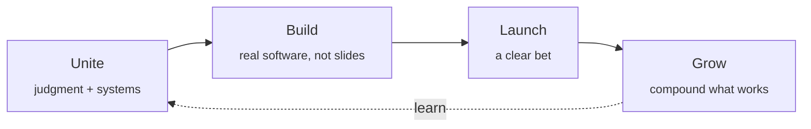

  

<h3 align="center">Unite mind and machine into ventures.</h3>

  We invent and own human–machine ventures — and partner selectively through a product studio. 
  Tandil, Argentina · Remote · Since 2016 · English & Español

  <a href="https://sinequix.com/en">Website</a> ·
  <a href="https://sinequix.com/en/products">Ventures</a> ·
  <a href="https://sinequix.com/en/services">Studio</a> ·
  <a href="https://sinequix.com/en/about">About</a> ·
  <a href="https://sinequix.com/en/contact">Contact</a> ·
  <a href="https://sinequix.com/es">Español</a>

---

## What we do

Sinequix is a polymath practice. The name comes from *synoecism* — the Greek process of uniting communities into a polis. We apply that idea to uniting human judgment with machine capability: **humans amplified by systems, not replaced by them.**

- **Mission:** turn messy domains into products people actually use.
- **Vision:** a focused set of durable human–machine ventures, not a services mill.

## Owned ventures

| Venture | Domain | What it is |
|---|---|---|
| [**Proof of X**](https://pox.me) | Digital identity | Portable identity and verifiable proof for people, organizations, and agent workflows. |
| [**Omnicost**](https://omnicost.com) | Construction | Cost control for budgets, documents, and project visibility. |
| [**Publitzr / ConLaTuya**](https://publitzr.com) | Civic information | Profiles, timelines, graphs, and evidence-backed public records. |
| [**Planeflare**](https://planeflare.com) | Tabletop RPG | Always-on campaigns with maps, sessions, and tools between games. |
| [**Chainsaw**](https://chainsawteam.com) | Creative studio | Production tooling and public surface for Chainsaw Team. |

## How we build

## Product Studio

When there's a fit, the studio helps ambitious teams do the same — with judgment, systems, and delivery.

| Engagement | How it works |
|---|---|
| **Turnkey builds** | Flat fee, fixed price, clear milestones. No open-ended retainers. |
| **Capacity subscription** | Monthly senior builder capacity for continuous shipping. |
| **Agentic delivery** | Agents handle fast execution; humans review architecture, design, and code. |

Focus areas: **strategy** (name the problem, the user, and the path to fit), **launch** (build, test, ship on a clear plan), and **technical leadership** (architecture that holds under growth).

Process: **Frame → Make → Ship → Grow.**

## Open source here

| Repo | About |
|---|---|
| [`enrailar`](https://github.com/sinequix/enrailar) | Propuesta de trenes argentinos con foco en Tandil. |

## Work with us

Send a brief at **[sinequix.com/en/contact](https://sinequix.com/en/contact)** — if it's a fit, we reply in English or Spanish.

---

<b>En español</b>

### Unir mente y máquina en ventures.

Inventamos y somos dueños de ventures. Cuando hay encaje, el Estudio de Producto ayuda a equipos ambiciosos a hacer lo mismo — con criterio, sistemas y entrega.

- **Proof of X** — Identidad portable y prueba verificable para personas, organizaciones y flujos con agentes.
- **Omnicost** — Control de costos para equipos de construcción que gestionan presupuestos, documentos y visibilidad de obra.
- **Publitzr / ConLaTuya** — Información cívica: perfiles, líneas de tiempo, grafos y registros públicos con evidencia.
- **Planeflare** — Campañas siempre activas para grupos de rol: mapas, sesiones y herramientas entre partidas.
- **Chainsaw** — Tooling de producción y superficie pública de Chainsaw Team.

Contacto: **[sinequix.com/es/contacto](https://sinequix.com/es/contacto)** · Tandil, Buenos Aires, Argentina.

